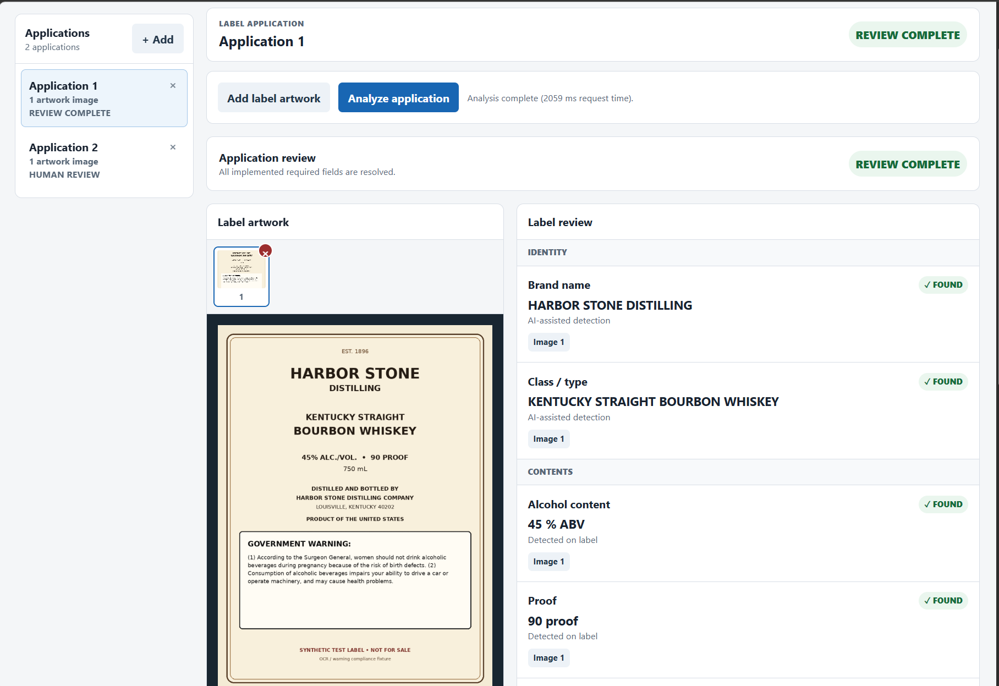
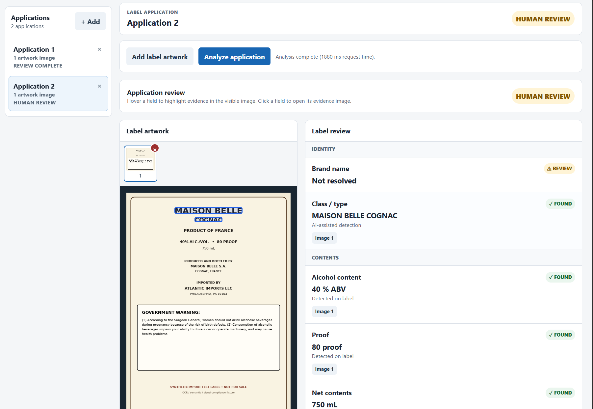
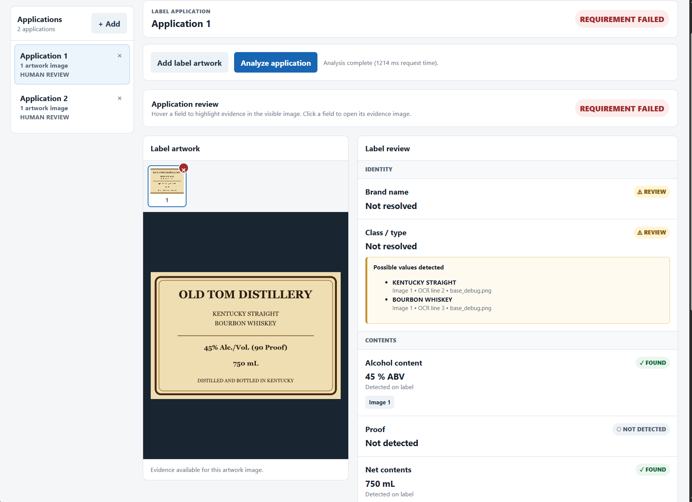

# AI-Powered Alcohol Label Verification

A standalone AI-assisted prototype for reviewing alcohol beverage label artwork against common TTB labeling requirements.

The application extracts and reviews label information including:

- Brand name
- Class/type designation
- Alcohol content
- Proof, when present
- Net contents
- Producer, distiller, bottler, and importer information
- Business addresses
- Country of origin for imported products
- Government Health Warning

The system combines deterministic extraction with semantic analysis and grounds extracted values back to observed label text. Cases that cannot be resolved safely are routed for human review rather than forcing an automated decision.

## Features

- Extracts brand name and alcoholic beverage class/type
- Extracts alcohol content, proof, and net contents
- Identifies producer, distiller, bottler, and importer information
- Grounds semantic results back to OCR evidence
- Associates businesses with addresses and business roles
- Reviews country-of-origin evidence for imported products
- Validates the Government Health Warning, including required text, uppercase heading, and visual boldness evidence
- Reconciles evidence across multiple uploaded artwork images
- Routes ambiguous or conflicting results to human review instead of selecting values by confidence alone
- Displays visual evidence highlights over uploaded artwork
- Preserves detailed audit output for technical review

## Screenshots

### Label Review

The reviewer interface presents the submitted artwork beside the
extracted label requirements so evidence can be reviewed without
switching between screens.



### Evidence Highlighting

Extracted values retain their underlying OCR evidence. Reviewers can
inspect the corresponding location directly on the uploaded artwork.



### Human Review

Ambiguous, conflicting, or compliance-sensitive results are routed to
`VERIFY` rather than forcing an automated decision.



### Multiple Artwork Images

Multiple pieces of artwork can contribute evidence to the same review
case.

## Architecture

The project is divided into an application layer and a reusable analysis library.

```text
Uploaded artwork
       |
       v
      OCR
       |
       v
OCR observations
(text, confidence, bounding boxes)
       |
       +---------------------+
       |                     |
       v                     v
Deterministic           Semantic
extraction              extraction
       |                     |
       +----------+----------+
                  |
                  v
             OCR grounding
                  |
                  v
          Per-image analysis
                  |
                  v
          Case reconciliation
                  |
                  v
       RESOLVED / VERIFY / ABSTAIN
                  |
                  v
             Reviewer UI
```

`app.py` provides the HTTP and UI boundary.

`lib/` contains the reusable analysis engine, including OCR processing, deterministic measurements, semantic resolution, evidence grounding, Government Warning validation, and case reconciliation.

## How Analysis Works

### Deterministic Extraction

Structured measurements such as alcohol content, proof, and net contents are extracted using deterministic rules where possible.

This avoids using model inference for values that can be reliably parsed from observed label text.

### Semantic Extraction

Semantic analysis is used for fields that require interpretation, including:

- Brand names
- Class/type designations
- Business information
- Business relationships
- Country-of-origin evidence

A single semantic extraction is shared across specialized resolvers to avoid unnecessary repeated model inference.

### Evidence Grounding

Semantic output is not accepted without supporting label evidence.

Semantic values are grounded back to OCR observations, including:

- Observed text
- OCR line indexes
- Confidence information
- Bounding boxes

This creates a traceable path from semantic interpretation back to visible label artwork. The evidence is preserved for audit and can be displayed in the reviewer interface.

### Human-in-the-Loop Decisions

The application does not force ambiguous evidence into a definitive answer.

Results use three high-level states:

- `RESOLVED` - required information was resolved without a blocking issue
- `VERIFY` - human review is required
- `ABSTAIN` - usable image evidence was not available

Ambiguous or conflicting evidence is preserved for review rather than resolved by confidence alone.

### Government Health Warning

The Government Health Warning is treated as a compliance check rather than simple text detection.

The analyzer checks features including:

- Presence of the warning
- Completeness of the required text
- Text agreement
- Uppercase `GOVERNMENT WARNING:` heading
- Visual evidence for the required bold heading

A failed or uncertain warning requirement routes the case to human review.

## Setup

The recommended way to run the application locally is with Docker.

### Requirements

- Docker Desktop or another Docker-compatible runtime
- A local copy of the semantic model
- Approximately 8 GB of available memory recommended for local execution

The application runs OCR and semantic inference locally and does not
require an external machine-learning API.

### Semantic Model

The application uses the GLiNER2.5 multilingual model for semantic
entity and relationship extraction.

Model:

`fastino/gliner2.5-multi-v1`

Download the model from Hugging Face:

https://huggingface.co/fastino/gliner2.5-multi-v1/tree/main

The model weights are not committed to this repository. Download the
model locally and place the model files under:

```text
model/
```

## Running with Docker

### Build the CPU Image

From the repository root:

```powershell
docker build `
    --platform linux/amd64 `
    --tag treasury-label-review:cpu `
    .
```

Docker caches the dependency layers, so application-only changes normally
do not require reinstalling the complete OCR and machine-learning stack.

### Run on Windows PowerShell

Mount the local semantic model into the container as a read-only
directory:

```powershell
docker run --rm `
    --name treasury-label-review `
    --publish 8000:8000 `
    treasury-label-review:cpu
```

Then open:

```text
http://localhost:8000/
```

### Run on Linux

```bash
docker run --rm \
  --name treasury-label-review \
  --publish 8000:8000 \
  treasury-label-review:cpu
```

Then open:

```text
http://localhost:8000/
```

## Docker Runtime

The CPU container uses:

- Linux / AMD64
- FastAPI
- Uvicorn
- PaddleOCR
- PaddlePaddle CPU runtime
- GLiNER2
- PyTorch CPU runtime
- Transformers
- OpenCV headless runtime

The deployed container uses CPU-compatible machine-learning runtimes.
Local development may use GPU acceleration separately.

## Verifying the Container

To verify the major runtime dependencies:

```powershell
docker run --rm `
    treasury-label-review:cpu `
    python -c "import paddle, torch, transformers, gliner2; print('Runtime imports OK')"
```

To confirm that the deployment image is using CPU inference:

```powershell
docker run --rm `
    treasury-label-review:cpu `
    python -c "import torch; print('Torch CUDA:', torch.cuda.is_available())"
```

and:

```powershell
docker run --rm `
    treasury-label-review:cpu `
    python -c "import paddle; print('Paddle CUDA:', paddle.device.is_compiled_with_cuda())"
```

A CPU deployment should report GPU/CUDA availability as false.

## Development Environment

The primary reproducible runtime is the Docker CPU image.

Development was also performed using a Windows GPU environment for
hardware-accelerated testing. GPU acceleration is optional and is not
required to build or run the CPU deployment.

Development versions included:

```text
Python              3.13.14
FastAPI             0.143.3
Uvicorn             0.54.0
PaddleOCR           3.7.0
PaddlePaddle GPU    3.2.2
GLiNER2              2.1.0
PyTorch              2.14.1+cu126
OpenCV               5.0.0.93
```

The Docker deployment intentionally uses CPU-compatible PaddlePaddle,
PyTorch, and headless OpenCV packages instead of the Windows
GPU-specific development packages.


## Deployment

The public assessment deployment runs the same containerized application
used by the local Docker workflow.

The deployment environment supplies the semantic model locally rather
than depending on an external inference API.

Deployed prototype:

```text
http://13.222.153.128:8000/
```

## Running the Application

Start the application from the repository root:

```powershell
python -m uvicorn app:app --host 127.0.0.1 --port 8000
```

For local development with automatic:

```powershell
python -m uvicorn app:app
```

Then open:

```text
http://127.0.0.1:8000/
```

## Using the Application

1. Open the reviewer interface.
2. Add one or more pieces of label artwork.
3. Run the label analysis.
4. Review the overall case status and extracted label requirements.
5. Use evidence links and highlights to inspect where results were detected.
6. Review any fields marked for verification.
7. Expand the audit details when technical evidence is needed.

## Testing

Run the complete regression suite:

```powershell
python -m pytest
```

Current local regression baseline:

```text
269 passed
1 xfailed
93% coverage
```

The test suite covers deterministic extraction, semantic resolution, OCR grounding, visual resolution, Government Warning validation, case reconciliation, API behavior, and failure/review paths.

## Project Structure

```text
.
├── app.py
├── html/
│   └── label-review.html
├── lib/
│   ├── api/
│   ├── batch/
│   ├── case/
│   ├── label/
│   ├── resolver/
│   │   ├── class_type.py
│   │   ├── visual.py
│   │   └── semantic/
│   ├── analyze_image.py
│   ├── ocr.py
│   ├── routing.py
│   ├── semantic_runtime.py
│   └── warning_label.py
└── test/
```

### Application Layer

`app.py` provides the HTTP and UI boundary and delegates label analysis to the reusable library.

### Analysis Library

`lib/` contains the reusable analysis pipeline:

- `api/` - API-facing image handling
- `batch/` - batch-processing support
- `case/` - case-level and cross-image reconciliation
- `label/` - label analysis, OCR evidence, and measurements
- `resolver/` - semantic and visual field resolution

### Tests

`test/` mirrors the production responsibilities so components can be verified independently.

## Design Decisions

### Deterministic Where Possible

Structured values such as ABV, proof, and net contents use deterministic parsing and validation when reliable rules are available.

This avoids spending model inference on values that can be reliably derived from observed label text.

### AI for Semantic Interpretation

Semantic inference is reserved for fields where context and meaning are important, including:

- Brand names
- Class/type designations
- Businesses
- Addresses
- Business relationships
- Country-of-origin evidence

### Ground AI Output in Observed Evidence

Semantic extraction is not treated as authoritative by itself.

Results must be associated with observed OCR evidence before being promoted to resolved values. This provides traceability from an AI interpretation back to visible label artwork.

### Do Not Force Uncertain Answers

Ambiguous, conflicting, or insufficiently grounded information is routed for human review rather than resolved by model confidence alone.

### One Semantic Inference Per Image

A single semantic extraction is shared across field-specific resolvers to reduce repeated model inference.

### Separate Application and Analysis Concerns

The HTTP/UI application is kept separate from the reusable analysis library.

This keeps transport and presentation concerns out of the core label-analysis logic.

## Tools and Technologies

The prototype uses:

- Python
- FastAPI and Uvicorn for the application/API layer
- PaddleOCR / PaddlePaddle for optical character recognition
- GLiNER-based semantic extraction for entity and relationship analysis
- OpenCV for image processing and visual analysis
- pytest and coverage tooling for regression testing
- HTML, CSS, and JavaScript for the reviewer interface

Third-party software and model artifacts remain subject to their respective licenses.

## Performance

The application minimizes repeated semantic inference and uses deterministic extraction for structured measurements.

Representative local runs have completed within the approximately five-second usability target identified in the assessment requirements.

Actual processing time depends on hardware, image complexity, OCR workload, and model execution.

### Runtime

The application supports CPU execution for containerized deployment.

Local development may use GPU acceleration when available, but a GPU is
not required to run the deployed prototype. The semantic model runtime
uses automatic device placement for the deployment environment.

Performance depends on the host CPU, image complexity, OCR workload, and
semantic model execution.

## Assumptions and Limitations

This project is a proof-of-concept reviewer aid rather than an authoritative regulatory determination system.

Key assumptions and limitations include:

- OCR quality directly affects downstream extraction quality.
- Low-resolution, distorted, unusually composed, or otherwise noisy artwork may require human review.
- Semantic extraction can produce ambiguous or partial results.
- The application intentionally favors `VERIFY` over guessing when evidence is insufficient or conflicting.
- Visual typography checks, including Government Warning boldness, depend on evidence available in the submitted artwork and may remain uncertain on difficult images.
- Alcohol beverage labeling requirements vary by beverage type. This prototype focuses on the common requirements described in the assessment.
- A production implementation would require additional security, operational, retention, accessibility, and regulatory validation.

## Hardening and Production Considerations

This repository is implemented as a standalone proof of concept. A
production deployment would require additional engineering and
operational controls beyond the scope of this assessment.

Areas for further hardening include:

### Security

- Add authentication and authorization appropriate to the deployment
  environment.
- Define explicit upload size, image dimension, and file-type limits.
- Validate uploaded content independently of client-provided filenames
  and MIME types.
- Run the application with least-privilege permissions.
- Perform dependency and container-image vulnerability scanning.
- Establish a regular dependency patching process.
- Define secure secret and configuration management rather than placing
  deployment-specific values in source control.

### Privacy and Data Handling

A production implementation would require explicit policies for:

- Uploaded-label retention
- Temporary-file cleanup
- Application and audit-log retention
- Access to submitted artwork and analysis results
- Handling of documents containing sensitive information
- Backup and deletion behavior

The current prototype should not be interpreted as implementing a
production federal records-retention or PII-handling policy.

### Model and Dependency Management

The OCR and semantic-model runtimes should be version-pinned for
reproducible deployments.

Production releases should also record:

- OCR model version
- Semantic model version
- Python dependency versions
- Container image version
- Application version

Third-party software and model licenses should be reviewed independently.
Model artifacts are not assumed to have the same license as the Python
libraries used to load them.

### Reliability

A production deployment should add operational protections such as:

- Health and readiness checks
- Structured application logging
- Request correlation
- Graceful failure handling
- Resource and request limits
- Monitoring for OCR and inference failures
- Deployment-level timeout handling

The existing `VERIFY` and `ABSTAIN` behavior should remain fail-safe:
uncertain analysis should continue to be routed to human review rather
than converted into a definitive compliance decision.

### Performance and Scalability

The prototype minimizes unnecessary inference by using deterministic
extraction where possible and sharing one semantic extraction across
field-specific resolvers.

Local hardware-accelerated testing demonstrated processing within the
approximately five-second usability target described in the assessment.
CPU/container performance should be benchmarked independently on the
actual deployment environment before making equivalent performance
claims.

Higher-volume production use would also require capacity testing for
concurrent requests and batch workloads.

### Testing and Validation

The automated regression suite provides coverage of the current
prototype behavior. Before production use, validation should be expanded
to include a larger and more representative corpus of real-world labels,
including:

- Different beverage classes
- Imported and domestic products
- Multiple artwork images
- Low-resolution or distorted images
- Unusual typography and layouts
- OCR degradation
- Ambiguous semantic fields
- Government Health Warning failures

Regulatory validation should be performed independently of software test
coverage.

### Accessibility and User Experience

The prototype is designed around a simple human-review workflow.
Production hardening should include formal accessibility testing,
keyboard-navigation testing, browser compatibility testing, and user
testing with representative compliance reviewers.

### Regulatory Scope

This application is a reviewer-assistance prototype. It does not replace
regulatory judgment and should not be treated as an authoritative TTB
compliance determination.

A production implementation would require validation of the applicable
rules for each supported beverage category and an operational process
for maintaining those rules as requirements change.

## Disclaimer

This application is a prototype created for a technical assessment.

It demonstrates an AI-assisted label-review workflow and is not an official TTB compliance determination, regulatory approval system, or substitute for qualified regulatory review.